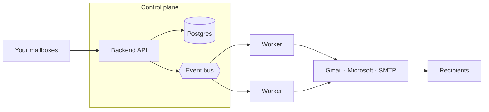

<div align="center">
  <picture>
    <source media="(prefers-color-scheme: dark)" srcset="docs/assets/logo-dark.svg">
    <source media="(prefers-color-scheme: light)" srcset="docs/assets/logo-light.svg">
    
  </picture>

  <p><b>Email warmup and permission-based sending, built to protect your sender reputation.</b></p>

  <p>
    <a href="#features">Features</a> ·
    <a href="#whats-new">What's new</a> ·
    <a href="#how-it-works">How it works</a> ·
    <a href="#quick-start">Quick start</a> ·
    <a href="#self-hosting">Self-hosting</a> ·
    <a href="#documentation">Docs</a>
  </p>
</div>

## Dakiya Mail

Dakiya Mail sends campaigns from the mailboxes you already own (Gmail,
Microsoft 365 or any SMTP/IMAP provider) and keeps them healthy so your mail
keeps reaching the inbox. Warmup, campaigns, a unified inbox and a CRM live in
one self-hosted dashboard, and your contacts, mail and credentials stay on your
own server.

It is designed for senders who mail people who asked to hear from them, and it
slows itself down when something looks wrong instead of pushing through.

## Features

**Warmup that stays safe**
- Gentle ramp per mailbox: about 10 a day, plus 1 a day, levelling off at 40
- Natural timing with random gaps, never on round clock times
- Backs off automatically when a warmup email lands in spam
- Health states per mailbox (healthy, watch, throttled, quarantined, blocked),
  so a risky mailbox leaves the pool before it hurts the others
- Warmup mail is filed into its own folder and never clutters your inbox

**Deliverability built in**
- SPF, DKIM and DMARC checks for every sending domain, with step-by-step fixes
- One-click unsubscribe (RFC 8058) and automatic suppression on bounce,
  complaint or unsubscribe
- Complaint and bounce monitoring against the 0.1% and 5% limits
- Conservative defaults: 50 cold emails a day per mailbox, 10 minutes apart

**One workspace for the whole job**
- Multi-step campaigns with per-mailbox caps and spacing
- Unified inbox across every mailbox
- CRM with contacts, pipelines, deals, tasks and meetings
- Visual automations with AI steps
- REST API, webhooks and integrations
- Live updates and presence across your team

## What's new

| Feature | What it does |
|---|---|
| **Gmail Postmaster Tools** | Shows Gmail's own view of your sending domains on the Deliverability page: domain reputation, spam rate against the 0.10% and 0.30% lines, and SPF, DKIM and DMARC pass rates. |
| **Pre-send checklist** | Before a campaign launches, checks authentication, complaint and bounce rates, unsubscribe headers, list quality and planned volume. Failures ask for confirmation instead of launching silently. |
| **Engagement-first sending** | Optionally mails your most engaged contacts first, and stops mailing people who have never opened, clicked or replied after a number of emails you choose. |
| **AI-written warmup** | Warmup emails written for each sender, with replies that answer what was actually said. Ships switched off and rolls out gradually. |
| **AI provider settings** | Choose the AI provider, key and model in the admin panel instead of environment variables. Keys are stored encrypted and never shown again. |

## How it works

Dakiya Mail splits into a **control plane** (backend API, consumer, Postgres,
Redis and an event bus) that owns all state, and an **execution plane** of
interchangeable Go workers that send and sync mail. Workers never touch
Postgres, and mail leaves through each mailbox's own provider, so you add
throughput by adding workers.



Secrets use envelope encryption with a local AES master key by default, or AWS
KMS if you prefer. See [architecture](docs/content/docs/development/architecture.mdx).

## Quick start

With Docker, Go 1.26 and pnpm installed:

```bash
git clone https://github.com/bitan-del/dakiya-mail && cd dakiya-mail
make dev
```

Open `http://localhost:5173` and sign in with `dev@dakiyamail.com` /
`password123`. The login code arrives in Mailpit at `http://localhost:18025`.

No Docker? Postgres, Redis, NATS and Mailpit can run natively instead: see
[LOCAL-DEV-NO-DOCKER.md](LOCAL-DEV-NO-DOCKER.md). For a fully populated demo
with live sending, replies and opens, see the
[sandbox guide](docs/content/docs/development/sandbox.mdx).

## Self-hosting

Dakiya Mail runs with no cloud account of any kind. One command brings up the
whole platform:

```bash
make up
```

`make up` waits for the backend and prints a one-time link that claims the
instance and makes you its admin. You need Docker with Compose v2 and about
10 GB of free disk. `make doctor` prints the instance state and every failing
check.

After installing:

- Set `CREDENTIALS_ENCRYPTION_KEY` (`make gen-key` creates one). Mailbox
  credentials, the AI provider key and Postmaster credentials are sealed with it.
- Set your AI provider in the admin panel under **Instance settings**, then
  restart the backend and consumer.
- To see Gmail Postmaster data, verify your domain at
  [postmaster.google.com](https://postmaster.google.com) and connect credentials
  on the **Deliverability** page.

The [self-hosting guide](docs/content/docs/development/deployment-guide.mdx)
covers production secrets, HTTPS, Gmail and Microsoft mailboxes, scaling
workers and backups.

## Documentation

The docs site source lives in [`docs/`](docs/) and runs with `make docs`.

| Read this | To learn |
|---|---|
| [Self-hosting guide](docs/content/docs/development/deployment-guide.mdx) | Install, production setup, backups and scaling workers |
| [First run](docs/content/docs/development/first-run.mdx) | Claiming the instance and the setup link |
| [Configuration](docs/content/docs/development/configuration.mdx) | Every environment variable and its default |
| [Local development](docs/content/docs/development/local-development.mdx) | Make targets, native services and seeding |
| [Troubleshooting](docs/content/docs/development/troubleshooting.mdx) | Common errors and the command that fixes each |
| [Warmup](docs/content/docs/guides/warmup.mdx) | Ramp, pools, replies and pool safety |
| [Deliverability](docs/content/docs/guides/deliverability.mdx) | Authentication, suppression, complaints and Postmaster |
| [Campaigns](docs/content/docs/guides/campaigns.mdx) | Sequences, the pre-send checklist, send order and sunset |
| [API reference](docs/content/docs/api/index.mdx) | Endpoints, authentication, permissions and webhooks |

## Contributing

Pull requests are welcome. Keep each one to a single logical change and open an
issue first for larger changes. Before opening a PR, run the checks for the
tree you touched: `make fmt` and `make lint` for Go, `pnpm typecheck` and
`pnpm lint` for the frontends. See [CONTRIBUTING.md](CONTRIBUTING.md).

## Security

Found a vulnerability? Report it privately through
[GitHub security advisories](https://github.com/bitan-del/dakiya-mail/security/advisories/new)
rather than a public issue.

## License

Apache License 2.0. See [LICENSE](./LICENSE). Dakiya Mail is derived from and
modifies open-source code released under the Apache License 2.0 and MIT; the
original copyright notices are kept in the LICENSE files, as those licenses
require.
